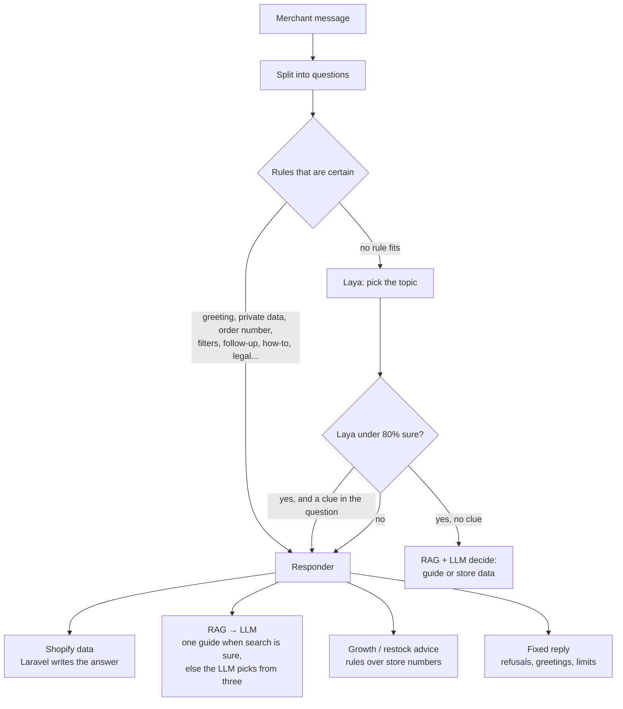

# TestJav: Shopify merchant assistant (backend)

A chat assistant that lives inside the Shopify admin and answers the **store owner's** questions about
their own store: orders, sales, products and stock, policies, settings, discounts, how to do things in
the admin, and how to grow sales.

> **Status: custom app, prototype.** This is installed as a Shopify **custom app** on one development
> store, through a custom install link. It is **not** a public App Store app and doesn't meet the
> public-app requirements yet (see [Limitations and roadmap](#limitations-and-roadmap)). The custom-app
> route was chosen because scopes are easier to get; the next project will be a public app built on
> what this one proves. For a review, start with [Strengths and weaknesses](#strengths-and-weaknesses).

It is built around three parts:

- **Laya**: a local, Jev-compatible decision model that picks the topic of a question.
- **RAG**: meaning search over 126 Shopify admin guides.
- **A small LLM** (Ollama): writes how-to answers from the guides.

Store facts never come from the model. Laravel reads them from the Shopify Admin API and writes the
answer itself, so numbers can't be made up.

This repository is the **Laravel API**. The embedded admin UI (React Router + Polaris) is a separate
app that calls this API.

---

## What it answers

| Ask | Example | Answered by |
|---|---|---|
| Orders | "where is order #1055", "did 1056 ship yet" | Shopify data |
| Order lists and counts with filters | "list my unfulfilled orders", "how many unpaid orders over $100", "orders that used WELCOME10", "my biggest orders" | Shopify data |
| Periods and follow-ups | "orders this week", "what about the week before?", "but I want unfulfilled" | Shopify data + conversation memory |
| Sales | "how much did I earn this month" | Shopify data |
| Products and stock | "beanie stock?", "products under $25 that are low in stock", "draft products", "what's out of stock" | Shopify data |
| What to reorder | "which products should I buy for my inventory" | Best sellers vs stock left |
| Growth advice | "how can I increase my sales" | Rules over the store's own numbers |
| Policies, settings, discounts | "what is my refund policy", "what timezone is my store set to" | Shopify data (policies summarised by the LLM) |
| How-to and admin pages | "how do I create a discount", "what is the Content page" | RAG → LLM |
| Legal and compliance | "do I need a cookie banner for GDPR" | RAG over Shopify Help Center pages + a fixed "not legal advice" line |

**What it refuses or redirects:**

- **Changes to the store** ("cancel order #1055"): the app is read-only, so it says so and explains how to do it.
- **Private data** (passwords, card numbers, API keys, every customer's address): refused by a fixed reply.
- **The future** ("how many orders tomorrow"): it can't predict, and says so.

---

## How a message is answered



**Key design choices:**

- **Rules first, Laya second.** A rule only fires when the wording makes the answer certain. Everything else goes to Laya.
- **Search decides when it's sure.** When the keyword match and the meaning search agree on a guide, or the top guide clearly leads, the LLM only writes from that one guide. That's faster and it can't pick a wrong guide.
- **Code writes the safety lines.** "I can't make changes in your store" and the legal disclaimer are added by code, not left to the model.
- **Conversation memory.** It remembers the last order, the products shown, the policy, the period and whether that answer was a list or a count, so follow-ups like "has it been delivered?" or "the day before?" work.
- **Laya down or slow (5 s timeout).** Clues in the question (an order number, a period, a setting, a product) route it instead.
- **Every routing decision is logged** in `intent_decisions`, with Laya's choice and confidence, the rules applied, and the search and LLM scores.

---

## Tech stack

| Part | What |
|---|---|
| API | PHP 8.3+, Laravel 13, SQLite (WAL) |
| Shopify | Admin GraphQL API, session-token auth (App Bridge), token exchange |
| Decision model | [Laya](https://github.com/NandhaKishorM/laya) (`english` checkpoint), Jev `/v1/systemone` protocol |
| LLM | Ollama, `qwen3.5:2b` (OpenAI-compatible API) |
| Embeddings | Ollama, `nomic-embed-text` |
| Keyword search | SQLite FTS5 (bm25) |
| Tests | PHPUnit (186 tests) |

---

## Project layout

```
app/
├── Console/Commands/      chat:eval, chat:test, guides:embed, jev:test
├── Enums/                 ChatIntent (topics), Responder (who answers), MessageRole, AwaitingAnswer
├── Http/
│   ├── Controllers/       ChatController (JSON + streaming), conversations, feedback, webhooks
│   ├── Middleware/        Shopify session token, webhook HMAC
│   ├── Requests/          input validation
│   └── Resources/         API response shapes
├── Models/                Shop, Conversation, Message, HelpArticle, IntentDecision
└── Services/
    ├── Chat/
    │   ├── ChatOrchestrator.php   routing and every answer type
    │   ├── MessageParser.php      dates, order numbers, filters, phrasing rules
    │   ├── GuideSearch.php        meaning search over guide embeddings
    │   ├── RoutingDecision.php    how a question was routed (logged)
    │   └── BotReply.php           the answer, its link and its scores
    ├── Shopify/
    │   ├── StoreData.php          contract for store reads
    │   ├── ShopifyStoreData.php   Admin GraphQL implementation
    │   ├── OrderFilter.php        order status/amount/discount/risk filters
    │   ├── ProductFilter.php      price/stock/status filters
    │   └── AdminApi.php, ShopifyAuth.php, SessionToken.php
    ├── JevClient.php              Laya / Jev decision API
    ├── ChatModelClient.php        LLM (streaming, guide pick with logprobs)
    └── EmbeddingClient.php        embeddings API
database/seeders/data/help-articles.json   the admin guides (with Help Center source links)
tests/
├── Feature/               behaviour tests (Shopify, Laya and the LLM are faked)
├── Fakes/FakeStoreData.php  a fixed sample store for tests and evaluation
└── Fixtures/              question sets for chat:eval
```

---

## Requirements

- PHP 8.3+ with the `pdo_sqlite` extension (with FTS5), and Composer
- Docker (Colima works on macOS) for Ollama and Laya
- About 8 GB of free RAM for both models
- A Shopify Partner app and a development store
- The frontend app, plus a public HTTPS URL for this API (a Cloudflare tunnel works for development)

---

## Setup

### 1. API

```bash
composer run setup              # install, copy .env, app key, migrate, build
php artisan db:seed --class=HelpArticleSeeder
```

### 2. Models

**Ollama:**

```bash
docker run -d --name ollama -p 127.0.0.1:11434:11434 ollama/ollama
docker exec ollama ollama pull qwen3.5:2b
docker exec ollama ollama pull nomic-embed-text
```

**Laya** (from a checkout of the Laya repository):

```bash
LAYA_PORT=8001 docker compose -f compose.http.yaml up -d laya-serve
curl http://127.0.0.1:8001/health
```

### 3. Guide embeddings (needs Ollama)

```bash
php artisan guides:embed          # all guides; use --missing after adding new ones
```

### 4. Configure `.env`

See [Configuration](#configuration). Never commit `.env`.

### 5. Run

```bash
PHP_CLI_SERVER_WORKERS=4 php artisan serve       # API on :8000
cloudflared tunnel --url http://127.0.0.1:8000   # public URL for the frontend
```

Put the tunnel URL in the frontend's `VITE_LARAVEL_API_URL`, then start the frontend with
`shopify app dev`. If a quick tunnel stays at 0 connections, add `--protocol http2`.

Try it without Shopify, in the terminal against the sample store:

```bash
php artisan chat:test
```

---

## Configuration

Only the app-specific settings are listed. See `.env.example` for the rest.

| Variable | Purpose | Default |
|---|---|---|
| `SHOPIFY_CLIENT_ID`, `SHOPIFY_CLIENT_SECRET` | Partner app credentials | required |
| `SHOPIFY_API_VERSION` | Admin API version | `2026-10` |
| `FRONTEND_ORIGINS`, `FRONTEND_ORIGIN_PATTERNS` | CORS: who may call the API from a browser | tunnel pattern |
| `CHAT_API_URL`, `CHAT_MODEL`, `CHAT_API_KEY` | LLM endpoint (OpenAI-compatible) | local Ollama, `qwen3.5:2b` |
| `CHAT_REASONING_EFFORT` | Stops thinking models from spending tokens on hidden reasoning | `none` |
| `CHAT_TIMEOUT` | Seconds before falling back to the guide text | `60` |
| `EMBEDDING_API_URL`, `EMBEDDING_MODEL` | Embeddings endpoint | local Ollama, `nomic-embed-text` |
| `DECISION_API_URL` | Laya (or Jev) `/v1/systemone` | `http://127.0.0.1:8001/v1/systemone` |
| `DECISION_MODEL` | Empty means `english`. For hosted Jev, the Jev model name. | `english` |
| `DECISION_API_KEY` | Only for hosted Jev | empty |
| `DECISION_TIMEOUT` | Seconds before routing by question clues instead | `5` |

App scopes: `read_orders`, `read_products`, `read_inventory`, `read_discounts`, `read_legal_policies`.
Without `read_all_orders`, Shopify shows the app only the **last 60 days** of orders, and answers say
so when a question reaches further back.

---

## API

All routes need a Shopify session token (`Authorization: Bearer <token>`) from App Bridge.

| Method | Route | What |
|---|---|---|
| `POST` | `/api/v1/chat` | Send a message. `Accept: text/event-stream` streams `status`, `delta` and `done` events; otherwise JSON. |
| `POST` | `/api/v1/conversations` | Start a new chat |
| `GET` | `/api/v1/conversations/latest` | The latest chat and its messages |
| `POST` | `/api/v1/messages/{message}/feedback` | `{"rating": "good" \| "wrong"}` on an answer |
| `POST` | `/api/v1/webhooks/app-uninstalled` | Shopify webhook (HMAC-checked): deletes the shop's data |

Each answer carries `answered_by` (e.g. `Laya → RAG → LLM`) and `confidence` (Laya, search, LLM), so the
UI can show who answered and how sure each part was.

---

## Tests and accuracy

**Behaviour tests** (fast, offline; Shopify, Laya and the LLM are faked):

```bash
php artisan test --compact
```

**Routing accuracy** against real Laya and the real LLM, on a copy of the database and the sample store:

```bash
php artisan chat:eval                                              # main set
php artisan chat:eval --file=tests/Fixtures/blind-questions.json   # owner-written set
php artisan chat:eval --file=tests/Fixtures/legal-questions.json
php artisan chat:eval --filter=howto-                              # by case id
```

It scores whether each question reached the right topic **and** the right target (the right guide,
order or policy), shows which layer made each wrong call, and saves the run to `storage/app/evals/`.
It does **not** score the wording of LLM-written text.

Latest results (295 questions):

| Set | Fully correct |
|---|---|
| Main (174, merchant wording) | 93% |
| Owner-written (100) | 96%, after tuning on it. Its first, untuned run scored 67%. |
| Legal (20) | 85% |

Don't run the evaluation while someone is using the app. Both share Ollama and Laya, which slows both down.

---

## Security and privacy

- **Read-only access.** The app only has read scopes and never changes the store.
- **No customer personal data is read.** Orders are fetched without names, emails or addresses.
- **Shop tokens are encrypted at rest.** Every API call is scoped to the shop in the session token.
- **Webhooks are HMAC-verified.** Uninstalling deletes the shop, its tokens and its chats.
- **Merchant words never reach Shopify's search.** Filters are built from fixed patterns, and discount codes are reduced to letters, digits, `-` and `_`.
- **Model output is cleaned.** URLs are stripped from it, and admin links come from the guides, never from the model.
- **Secrets stay in `.env`.** The databases, `.env` and evaluation copies (`storage/app/evals/`) are git-ignored.

---

## Strengths and weaknesses

An honest assessment for review.

### Strengths

- **Numbers can't be hallucinated.** Order, sales, stock, policy and settings answers come from the Shopify API, and Laravel writes them. Growth and restock advice are rules over those numbers, not model text.
- **Measured, not guessed.** `chat:eval` runs 295 merchant questions through the real pipeline, scores topic and target, and names which layer made each wrong call. Every live decision is logged in `intent_decisions`, with 👍/👎 feedback per answer.
- **Safety is in code.**
  - The app has read-only scopes.
  - Refusals (private data, the future) and the "can't change your store" and legal-disclaimer lines are written by code, not the model.
  - Search filters come from fixed patterns, so merchant words never reach Shopify's search.
- **It degrades instead of failing.**
  - **Laya down or slow:** clues in the question route it.
  - **LLM down:** the guide's own steps are shown.
  - **Shopify error:** a clear message.
- **Fast where it matters.** Data answers take about 1 s. How-to answers start in 3–4 s, because a search that's sure skips the model's guide choice.
- **186 behaviour tests,** with Shopify, Laya and the LLM faked.

### Weaknesses

- **Routing is mostly hand-written rules.**
  - `ChatOrchestrator.php` is about 2,000 lines, with 35 named routing rules. Most of the regex patterns live in `MessageParser` (about 800 lines).
  - Rules interact: a new rule can break an older case. That's why every change is re-measured.
  - It's the hardest part to maintain. It should be split into a router plus one class per answer type.
- **Accuracy is partly tuned on the test sets.**
  - The owner-written set scored 67% on its first, untuned run, and 96% only after rules were written from its failures.
  - Expect lower accuracy on wording nobody has tried.
  - The evaluation scores routing and target, **not** the wording of LLM answers.
- **Laya adds little on its own.**
  - It's about 60–70% right alone, not fine-tuned, and pinned to English.
  - Rules carry most of the routing, so this prototype doesn't yet show how a fine-tuned Laya would compare with Jev.
- **The small LLM is the weak link.**
  - `qwen3.5:2b` on CPU is slow: how-to answers finish in 9–13 s.
  - About 1 in 10 times it picks the wrong guide when search isn't sure.
  - It can still invent a step in a how-to answer.
- **Custom-app shortcuts:**
  - No compliance webhooks, and the uninstall webhook wiring is unconfirmed.
  - It runs on quick Cloudflare tunnels, with local Ollama and Laya, SQLite and no job queue.
  - It has never been tested with several shops or users at once. Laya and Ollama share CPUs, and Laya times out under load or after a long idle.
- **Data limits:**
  - Only the last 60 days of orders are visible.
  - No customer data, profit, traffic or conversion figures.
  - The product price filter checks the first 40 matching products.
- **English only.** The rules, the guides and the pinned Laya model are all English.
- **No CI pipeline yet.**

---

## Limitations and roadmap

**Known gaps:**

- **2B model guide picks:** the small LLM sometimes picks the wrong guide when search isn't sure (about 1 in 10 how-to questions).
- **Speed on CPU:** how-to answers start in about 3–4 s and finish in 9–13 s. Data answers take about 1 s.
- **Laya:** pinned to the English checkpoint, and slow on a cold start after a long idle.
- **No profit answers yet,** and no customer, traffic or conversion insights.

**Before an App Store release:**

- The mandatory compliance webhooks: `customers/data_request`, `customers/redact`, `shop/redact`.
- Confirm that Shopify's `app/uninstalled` webhook reaches `/api/v1/webhooks/app-uninstalled`. The app config sends it to the frontend first.
- Protected customer data access for orders, requested in the Partner Dashboard.
- Hosted Ollama and Laya (or hosted Jev), and a fixed API URL instead of quick tunnels.
- Billing API, if the app charges.
